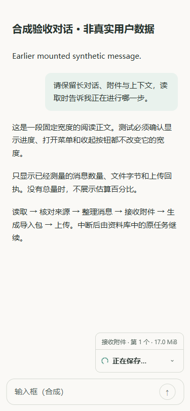
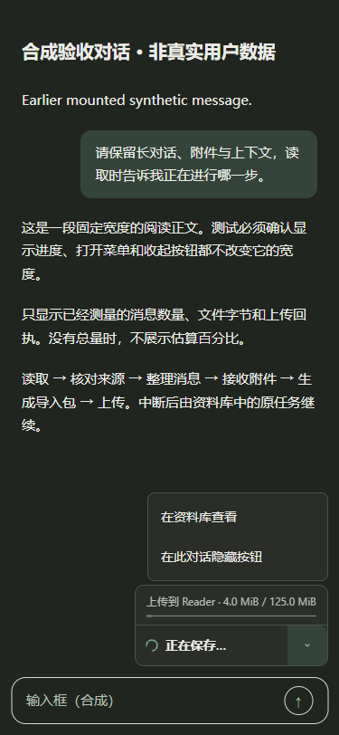
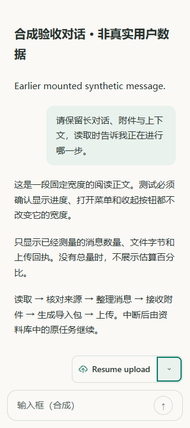

# 插件采集上限与读取进度 — 2026-11-25

**本地候选，不是发布回执。** Reader 基线 `c9cfb131d6704f2d2c095b93355629740e95cac5`，
Fork 基线 `be5e8dabd772809635db345a51c8c15c26b468ed`，均为
`codex/reader-extension` 的已有工作树；没有新建分支、提交、推送、CI、
Release、生产操作或备份清理。只用了两个子智能体，分别处理后端长正文和
扩展进度／压力回归；主智能体完成分块采集、续传协议、安全复审及整合。

本记录只验收「取消插件人为采集门槛、读取过程可见」专项。此前完整的资料库
搜索、浮层、短码、设置与批量导入计划仍需独立完成和验收；不能把这里的通过
当作整个工作树的可发布证明。当前生产以 `PROJECT_STATE.md` 的上线记录为准。

设计包核对：直接读取用户提供 ZIP 的 `DESIGN.md`、`CODEX_PROMPT.md`、
`QA.md`，查看 `05-save-menu.png`、`15-batch-queue.png`，没有运行包内脚本。
本专项沿用保存按钮旁的轻量反馈和真实任务状态，不新增仪表盘或第三个常驻
网页按钮。包内原生侧栏示意与用户后续明确的共用浮层把手有差异，以后者
为准；这不代表已完成其余 20 状态或真实批量来源验收。

## 已查实的根因与改动

| 事实／问题 | 改动 | 本次证据 |
|---|---|---|
| 旧插件主动拒绝 8/32 MiB 来源 JSON、16 MiB 附件、100 MiB 包、2 MiB 单消息及 50,000 条消息 | 字节范围索引、逐条转换、分块正文／附件 IPC、OPFS ZIP；不是只提高常量 | 真实 writer 产生 121,218,852 字节 ZIP，含 50,001 条消息、3,456,033 字节首条正文和 105,906,195 字节附件 |
| 单消息到服务端还会经过普通 Markdown 的边界和尺寸判断 | Reader 索引先确立消息边界，随后校验正文和附件；长正文以摘要旁文件进入原有导入草稿 | 65,000 段合成正文通过真实认证、上传、分析、原子入库，未截断正文 |
| 大整包上传中断容易留下“结果未知” | 设备／用户／目标／大小／摘要绑定；4 MiB 分块，持久化后确认偏移，整包接收前不入队 | 真 PostgreSQL 并发起传、重复块、独立用户、过期暂存、重复完成；浏览器 host 重启及收据模型测试 |
| 保存只显示笼统忙碌；虚拟历史挂载使票据失效并抹去进度 | 显示实际阶段／页数／条数／字节，无总量不伪造百分比；仅真实分支变化失效 | Edge 合成页面四组场景，正文宽度变化 0 CSS px，历史挂载后持续显示进度 |
| Windows 内存探测反复创建 ctypes 类型，检测本身消耗内存 | 缓存结构体类型；逐行迭代正文，按真实块数和长块行数检测预算 | 修复前 20,000 次 RSS 探测约增加 148.4 MiB；修复后实际执行三种探测各 20,000 次，观测 RSS 增量 0 字节 |

内存结论只适用于这些测量。单个巨大正文仍受真实可用 RAM、64 MiB 工作区、
实例导入政策和存储限制；没有声称“任何体积一定成功”。资源缺失仍要求部分
完成复核，不因正文可用就显示完整成功。完整保存和最多 250 条的人工选择性
追加是不同合同。

## 本次通过结果

| 检查 | 结果 | 边界 |
|---|---|---|
| 最终 Node 24 全套 | 140 passed / 0 failed / 63 skipped | 203 项；63 项为原有私有夹具缺失，不计通过 |
| 最终 API 长正文、续传、内存与既有诊断／小 ZIP 回归 | 148 passed，103.48 秒 | Windows／SQLite；真实 RSS 和原 64 MiB 门槛保留 |
| 最终隔离 PostgreSQL 17 续传 | 2 passed，11.38 秒 | 实际迁移、锁、磁盘及收据；不是整个 API 的 PostgreSQL CI |
| 两仓真实大 ZIP 协议校验 | 50,001 条全部遍历；正文／附件摘要和关联通过，5.204 秒 | 真实插件 writer 的文件由 Reader 读取；不是 50,001 条全部 canonical 入库的计时 |
| Edge 158 实际渲染 | 1440、375、320px；中文／英文／暗色，4 场景通过 | 合成来源、模拟 runtime；不是登录 ChatGPT 的端到端测试 |
| Alembic heads | 唯一 `20261125_0065` | 0065 来自之前的短码配对改动；本专项无新增迁移 |
| 两仓 `git diff --check` | exit 0 | LF/CRLF 提示保留，不是内容错误 |

另有较早整合检查 127 passed / 2 skipped（Windows 无创建 symlink 权限）；
后端子任务最后一轮 145 passed、小 ZIP 31 passed。这些运行存在覆盖重叠，
不相加，也不代替最后文件快照。原始命令、日志、退出码和 SHA-256
在 [verification.json](verification.json)。

大 ZIP SHA-256：
`e71501690246fe4228843ddaf087a2efe0c9752a456f36407fca8567553795b6`。
ZIP 写入单元最大 262,144 字节；正文、索引缓冲允许最后一小片超过目标块边界，
没有把整个 ZIP 留在内存。附件完整传输不等于任意外部文件格式已安全解析。

## 实际画面

这些是**真实 Edge 渲染合成页面**，不是 ChatGPT 线上截图。
无总量的读取与附件阶段不显示百分比；已知上传字节显示细进度条。
暂停后能进入原任务继续，不在页面伪装已保存。





浏览器原始几何、阶段和截图索引：[browser-results.json](browser-results.json)。
基线是同一合成正文尚未注入控件的宽度，**不是旧版插件的完整视觉验收**。
原失败提示来自用户提供的截图，旧门槛另由源码确认。

## 失败与未验证项不隐藏

- 初次 API 长正文用例在原 Markdown 路径、空模板验证及工作区检查失败；
  分别修复索引识别顺序、正文旁文件和真实内存探测，不放宽原测试或资源门禁。
- 初次使用 PATH 中 Node 20，因不支持 `--test-force-exit` 退出 9；
  改用已安装 Node 24 后重跑完整套件。
- 早期大 ZIP fixture 声明附件但正文没有实际资源链接，不能通过 Reader 合同；
  已补真实引用并重新生成，再进行跨仓校验。旧 fixture 及日志保留，不作为成功证据。
- 一次新增权限测试把 Web Origin 的拒绝误写成 401；实际先返回 403。
  修正测试区分未登记 Origin 的 403 与允许 Origin 无 bearer 的 401，没有放宽认证。
- Edge 原用例揭示历史挂载后停止更新、菜单失焦、阶段末次计数被覆盖；修复后重跑。
  不删除之前的失败日志。
- **未验证：**本轮 Chrome 真扩展安装、真实 ChatGPT 来源及项目目录、真实账号网络中断、
  Linux 640 MiB worker 的该候选完整端到端、整站构建／全量 CI、正式分发和生产升级。
- 旧 API/worker 不支持本候选新建的长正文旁文件。上线需要同版 API/worker；
  旧插件上传合同保留，但不能把新内部草稿交给旧 worker。来源采集能力先查
  `resumable_capture`，旧服务明确要求升级。详细[兼容合同](../../system/BROWSER_EXTENSION.md#capture-streaming-candidate)。

## 复现入口

所有数据为合成内容；不要拿真实对话、令牌或生产卷替换 fixture。先设置本任务
专用 `TEMP`/`TMP`，新的复跑使用独立子目录，保留已有失败日志。

```powershell
$T = 'E:\chat-reader-temp\capture-recheck-20261125'
New-Item -ItemType Directory -Force -Path $T | Out-Null
$env:TEMP = $T; $env:TMP = $T

# Fork，使用 Node 24；路径采用本机已安装 runtime
Set-Location E:\1project\chat-intelligent-ui-exporter
$node = 'C:\Users\86182\.cache\codex-runtimes\codex-primary-runtime\dependencies\node\bin\node.exe'
& $node --test --test-force-exit tests/*.test.cjs
& $node scripts/reader-progress-check.cjs "$T\browser"

# Reader
Set-Location E:\1project\chat-reader\apps\api
& E:\anaconda\python.exe -m pytest `
  tests/test_memory_probe_windows.py tests/test_diagnostics_safety.py `
  tests/test_extension_transfer.py tests/test_reader_long_message_storage.py `
  tests/test_small_zip_memory_budget.py -q --tb=short --basetemp "$T\pytest"
```

大包测试会输出 task-owned `import.zip` 路径及摘要；在 Reader API 环境中对该文件
依次运行 `reader_package.package_header`、`verify_assets`、完整遍历 `messages`，
核对上述消息数、字节数和摘要。PostgreSQL 另需**自己创建的独立测试实例**，
设置其 `DATABASE_URL` 与 `SETTINGS_POSTGRES_INTEGRATION=1`，运行
`tests/test_extension_transfer_postgres.py`；不要指向生产。该测试的 schema fixture
负责迁移并清理本次隔离数据库。本次专用实例运行于回环端口 56328，收尾关闭，
数据目录和日志留在任务临时目录，不影响其他 PostgreSQL 实例。
